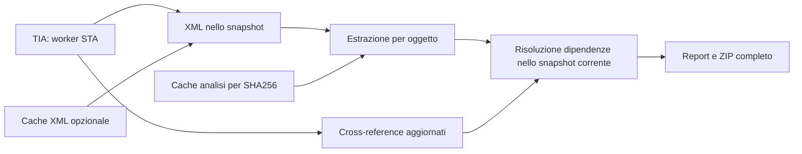

> Aggiornamento V1.0: questa pagina descrive anche il comportamento storico V0.9. La cache XML ora usa `xml-v2` e richiede prova del progetto e copertura del fingerprint attestata per l'intero XML. Nel reale V21 tale copertura non è ancora attestata: si riesporta. Vedere [EXPORT-RELIABILITY.md](EXPORT-RELIABILITY.md) per regole correnti, modalità e misure.

# Riferimenti, cache e metriche · V0.6

La pipeline separa chiamate Siemens e calcolo locale:

## Riferimenti ufficiali

L'adapter usa `CrossReferenceService.GetCrossReferences(AllObjects)` e conserva
source, reference, device/path, posizione, accesso e tipo di riferimento.
Non assume che UnderlyingObject sia disponibile per i membri e non inventa una
corrispondenza con reti XML. `crossreferences.json` conserva le informazioni grezze;
la ricerca le affianca alle evidenze XML con provenienza e accesso.
`CrossReferencesStatus` nel manifest distingue Available, Unavailable, Failed,
Partial, NotRequested e Demo. Un errore di servizio non elimina gli XML esportati.

## Due livelli di cache

- **Cache analisi**, attiva per default: chiave basata su versione parser, SHA256
  del file, identità e metadati dell'oggetto e modalità del report. La risoluzione
  delle dipendenze viene sempre rifatta sull'intero snapshot corrente.
- **Riuso XML**, opzionale e inizialmente disattivato: richiede tutte le impronte
  disponibili da `FingerprintProvider`, identità del progetto su disco, versione
  Base/Step7 e opzioni di export. Include impronte di commenti/proprietà/interfaccia,
  non solo ProgramCode. Se le impronte mancano o non sono valide si esporta normalmente,
  senza compilare il PLC. Le tabelle tag vengono sempre esportate.

Le impronte vengono ricontrollate dopo la lettura. Se cambiano durante un riuso,
il file viene scartato e riesportato. Oggetti con impronta instabile non entrano
in cache. Questo non trasforma l'intera raccolta in una transazione atomica.
Verificare il riuso su progetti reali rappresentativi prima di adottarlo stabilmente.

La directory `.tia-cache` è nella destinazione scelta. I blob sono versionati,
scritti atomicamente e verificati con SHA256 durante il ripristino. Dati corrotti
o cache inaccessibile producono un avviso e una nuova elaborazione. Nessun dato
Siemens è conservato come oggetto live fuori dal worker. I cross-reference sono
interrogati nuovamente anche quando un XML è riutilizzato. Ogni ZIP resta autonomo
e include tutti i file dichiarati; non è un archivio delta.

## Report e misure

I report compatti evitano di duplicare NetworkSource negli indici/Markdown.
Gli XML originali restano completi. È possibile disattivare Report compatti.
Le dichiarazioni sono indicizzate per oggetto, evitando ricerche lineari ripetute.

`metrics.json` registra tempi di export (comprese API), analisi, scrittura documenti
e compressione del payload, conteggi di riuso e cross-reference e memoria gestita
prima/dopo l'analisi. Non è una misura del picco RAM. Il tempo ZIP esclude il file
metriche stesso e la chiusura della directory dell'archivio. I contatori non
dimostrano un'accelerazione su progetti reali: servono confronti freddo/caldo reali.

Fonti V21: [cross-reference](https://docs.tia.siemens.cloud/r/en-us/v21/tia-portal-openness-api-for-automation-of-engineering-workflows/tia-portal-openness-api/functions-for-accessing-the-data-of-a-plc-device/functions-for-accessing-plc-service/getting-cross-references-for-step7),
[fingerprint](https://docs.tia.siemens.cloud/r/en-us/v21/tia-portal-openness-api-for-automation-of-engineering-workflows/tia-portal-openness-api/functions-for-accessing-the-data-of-a-plc-device/blocks/changing-blocks-using-fingerprints).
